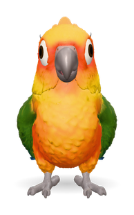
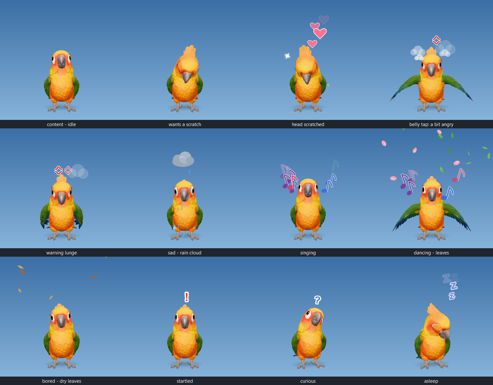
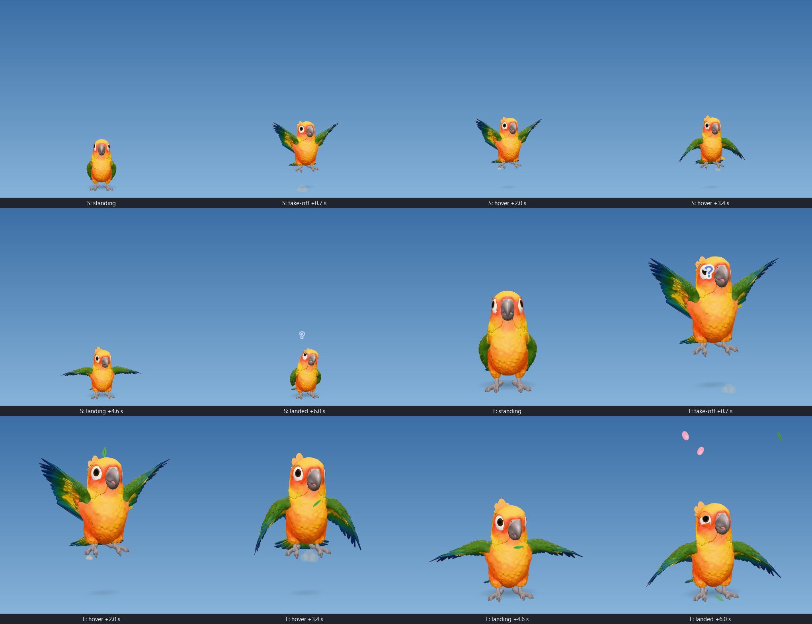
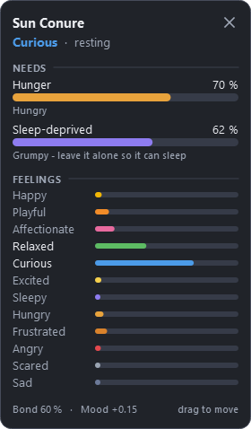

# DesktopPets3D



**A 3D sun conure that lives on your desktop.** It stands on your screen (or on the taskbar), follows your mouse
with its eyes, head and body, loves a head scratch, gets cross when you poke it, calms down when you pet it or give it
a treat, gets grumpy when you keep it up too late, and takes off, hovers and lands when you ask. Its moods come from a small
neural emotion network, not from a script.

Windows and macOS. Free and open source.

<br clear="right">



## Features

- **A real 3D bird** - a rigged sun conure with 72 baked animations, drawn with live lighting in a transparent,
  always-on-top window. Clicks next to the bird go straight through to your desktop.
- **It watches you** - eyes, head and body (±30°) follow the mouse; it blinks, tilts its head and looks up at you.
- **Pet it or poke it** - move the cursor up and down over its head to scratch it; left-click to poke it.
  Ordinary mouse movement never makes it angry: only clicking does, and petting or a treat calms it again.
- **Emotions that make sense** - 17 emotions (happy, playful, affectionate, curious, sleepy, frustrated, angry,
  scared, ...) in a continuous-time recurrent neural network, driven by hunger, sleep, attention and what your
  hand does. It remembers how you treat it.
- **Body clock** - it gets sleepy in the evening and sleeps at night. Keep it awake and it becomes sleep-deprived and
  grumpy - and a treat will not fix that; only sleep does.
- **Fly** - right-click > Fly: it takes off, hovers for a few seconds and lands.
- **Mood panel** - a separate little window with its hunger, how sleep-deprived it is, and how it feels.
- **Sounds** - 86 sounds: conure calls and chirps from Freesound recordings, plus beak, wing and seed sounds;
  the beak moves with every call.
- **Three sizes** - Small (default), Medium, Large. Female and male looks.
- **Modular** - every species is a plugin folder (`pets/<id>/`): model, animations, emotion engine, sounds, menu.

## Download and run

### Ready-made app (no Python needed)

Get the zip for your system from the **Releases** page of this repository.

| | Windows 10/11 (64-bit) | macOS on Apple silicon (M1 or newer) |
|---|---|---|
| File | `DesktopPets3D-windows-x64.zip` | `DesktopPets3D-macos-arm64.zip` |
| Install | Unzip anywhere (e.g. `Documents\DesktopPets3D`) | Unzip, drag `DesktopPets3D.app` to Applications |
| Start | Double-click `DesktopPets3D.exe` | Right-click the app > **Open** the first time (it is not signed - see below) |
| Quit | Right-click the bird > Quit, or the tray icon | Right-click the bird > Quit, or the menu-bar icon |

Windows may show "Windows protected your PC" for an unsigned app: **More info > Run anyway**. On macOS, if it says the
app "is damaged" or "cannot be verified", run once in Terminal: `xattr -dr com.apple.quarantine /Applications/DesktopPets3D.app`.
Details and troubleshooting: [docs/INSTALL.md](docs/INSTALL.md).

### From source (Windows, macOS, Linux)

Needs Python 3.10 or newer.

```text
Windows:  setup_windows.bat     then  run.bat          (run_debug.bat shows errors in a console)
macOS:    bash setup.sh         then  bash run.sh      (or double-click run_mac.command)
Linux:    bash setup.sh         then  bash run.sh      (X11 desktop)
```

## How to play with it

| Do this | The bird |
|---|---|
| Move the mouse around | Follows it with eyes, head and body. Normal movement nearby makes it happy and playful. |
| Hold the cursor close to it | Gets curious: peeks, tilts its head, then comes over and asks for a scratch. |
| Rest the cursor on its head | Relaxes: eyes droop, leans into your hand. |
| **Move the cursor up and down over its head** | **Head scratch** - leans in, eyes half-closed, hearts. Calms an angry bird. |
| Scrub wildly right on top of it | A bit annoyed. That is the most the cursor alone can do. |
| **Left-click it** (head or belly) | **A poke** - a bit angry (the belly annoys most). Keep clicking: very angry, warning lunges. |
| Press and drag | Carries it somewhere else; it stays there. |
| Right-click (Mac: two-finger click or Ctrl+click) | The menu - never counts as a poke. |

**Right-click menu:** Pet (head scratch) · Poke · Offer a sunflower seed · Offer millet · Play · **Fly** · Size
(Small / Medium / Large) · Look (female / male) · Sound (mute, volume, quieter when you are away) · Mood panel · Hide · Quit.



## The mood panel



Right-click the bird > **Mood panel**. It opens as its own small window - drag it anywhere, close it with ×; it
remembers where you put it.

- **Hunger** - goes up over a few hours; a sunflower seed fills it most, millet a little. (The bird has its own bowl,
  so it never starves; the meter is its appetite for treats.)
- **Sleep-deprived** - goes up when the bird is kept awake past its bedtime (from about 21:30-22:00) or keeps being woken. A
  sleep-deprived bird is grumpy: easily frustrated, quicker to anger, less playful - and treats will not cheer it up.
  Leave it alone in the evening and it falls asleep and recovers.
- **Feelings** - twelve fixed rows (happy, playful, affectionate, relaxed, curious, excited, sleepy, hungry,
  frustrated, angry, scared, sad) and, at the top, its main mood and what it is doing right now.

More in the [user guide](docs/USER_GUIDE.md).

<br clear="right">

## How it thinks

The sun conure runs **ConureMind**, a continuous-time recurrent neural network written from bird behaviour research
and affective neuroscience rather than trained on data:

1. **Senses** - where the cursor is and what it is doing (resting, moving gently, scratching, scrubbing), clicks,
   treats, the clock, whether you are at the computer.
2. **Body** - hunger, sleep pressure (with its own day/night clock), sleep debt, social need, boredom, stress, need
   for touch.
3. **Learning** - what your hand usually means (scratches or pokes), when food tends to come, trust in you.
4. **17 emotion neurons** - leaky integrators with excitation and inhibition between them; petting and food speed up
   the fading of anger and fear; a poke cuts through contentment; lost sleep makes the bird irritable.
5. **30 behaviours** compete for the body (rest, preen, play, ask for a scratch, sulk, threaten, sleep, ...) and pick
   one of the 72 animations; sounds and little effects (hearts, notes, anger marks, Zzz) follow.

It is a plausible, inspectable simulation - not a measurement of a real bird's feelings. The full explanation, with
equations and sources: [pets/sun_conure/engine/README.md](pets/sun_conure/engine/README.md).

## Under the hood

```text
app/        Python + Qt (PySide6): windows, click-through, menus, tray, mood panel, engine loop, memory
web/        Three.js page shown in each pet window: 3D model, gaze/blink/lip-sync, touch, 2D effects, audio
pets/       sun_conure/ (model, 72 clips, ConureMind engine, 86 sounds, menu, panel)   _template/ (new species)
packaging/  PyInstaller recipe for the Windows and macOS apps
docs/       install, user guide, architecture, adding a pet, building, publishing
tests/      24 unit tests        .github/workflows/  automatic Windows + macOS builds
```

Your pet's memory, settings and logs are kept per user: `%APPDATA%\DesktopPets3D` (Windows),
`~/Library/Application Support/DesktopPets3D` (macOS). Nothing is sent anywhere: the app only talks to itself on
127.0.0.1. It does not record keys, screen content or cursor history.

## Documentation

| Document | For |
|---|---|
| [docs/INSTALL.md](docs/INSTALL.md) | Installing and running on Windows and macOS, from the release or from source; troubleshooting; uninstalling |
| [docs/USER_GUIDE.md](docs/USER_GUIDE.md) | Everything you can do with the bird, the menu, the mood panel, sleep and hunger |
| [docs/ARCHITECTURE.md](docs/ARCHITECTURE.md) | How the software works: files, the per-frame pipeline, gaze, touch, sounds, flight, platforms, verification |
| [docs/ADDING_A_PET.md](docs/ADDING_A_PET.md) | Adding a new species: folder layout, full `pet.json` reference, engine contract |
| [pets/sun_conure/engine/README.md](pets/sun_conure/engine/README.md) | The conure's emotion engine in detail |
| [docs/BUILDING.md](docs/BUILDING.md) | Building the Windows and macOS apps yourself, and the automatic GitHub builds |
| [docs/PUBLISHING.md](docs/PUBLISHING.md) | Putting this project on GitHub and making a release |
| [CHANGELOG.md](CHANGELOG.md) | What changed in each version |

## Status and honest notes

- Version 0.4.0. Developed and tested on Windows 11 (unit tests, interaction-rule tests at all sizes, simulated days,
  visual review sheets, the built `.exe` self-test).
- **macOS:** the code has a macOS layer and GitHub builds the `.app`, but it has **not yet been run on a real Mac**.
  Reports welcome.
- About 2-3 % CPU and ~600 MB RAM (most of it is the embedded Chromium that draws the 3D bird).
- In sharp profile head turns the tip of the tongue can show at the beak line (a detail of the model).
- Walking animations play in place; the bird does not wander across the screen.

## Credits and licences

- Code: MIT - see [LICENSE](LICENSE).
- 3D model: Model created with Meshy - CC BY 4.0 License; rigged and animated for this project. Details:
  [pets/sun_conure/ASSETS.md](pets/sun_conure/ASSETS.md).
- Sounds: Freesound recordings (CC0, two CC BY) - see [pets/sun_conure/sounds/CREDITS.md](pets/sun_conure/sounds/CREDITS.md).
- Libraries: Qt / PySide6 (LGPL v3), Three.js (MIT), NumPy (BSD) - see [THIRD_PARTY_NOTICES.md](THIRD_PARTY_NOTICES.md).
